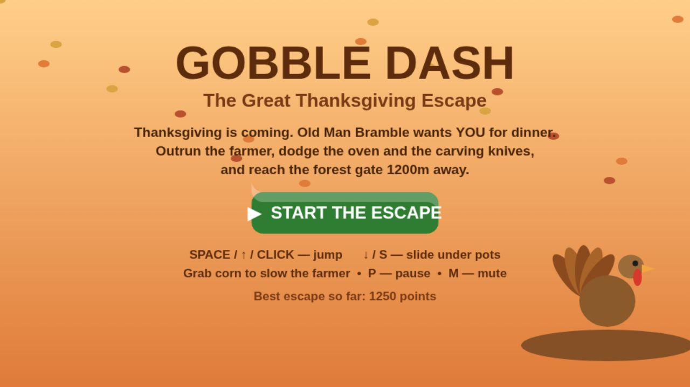

# Gobble Dash — The Great Thanksgiving Escape

[](https://make.fun/c/turkey-run-game-01)
[](https://make.fun/c/turkey-run-game-01)
[](https://make.fun/c/turkey-run-game-01)

An entry for the make.fun bounty **[Make the best turkey escape game](https://make.fun/c/turkey-run-game-01)** ($250, top 20 share).

> Thanksgiving is coming. Old Man Bramble wants **you** for dinner. You are
> Giblet the turkey — outrun the farmer, dodge the oven and the carving
> knives, and reach the forest gate 1200m away.



## Play it

```sh
node serve.ts
# open http://localhost:8080
```

No build step, no network: `game/` is plain static files. Open
`game/index.html` in desktop Chrome and it plays offline.

| Control | What it does |
| --- | --- |
| `Space` / `↑` / `W` / click | Jump |
| `↓` / `S` | Slide under the hanging pots |
| `P` / `Esc` | Pause |
| `M` | Mute |
| `R` / `Enter` | Run again after an ending |

## The game

A side-scrolling escape runner in three stages — **the farmyard**, **the
barn**, **the kitchen** — each faster and meaner than the last:

- **The farmer chases you.** Every stumble lets Old Man Bramble close in;
  corn cobs slow him down again. Slide low and he loses your trail and
  stops to search. If the gap hits zero, you are caught.
- **Hazards:** hay bales and fences to jump, rolling pumpkins, carving
  knives that fall where the red `!` warns you, ovens whose flames rise and
  fall in a rhythm, and hanging pots you must slide under.
- **Pickups:** corn (+50, pushes the farmer back), golden feathers (+200),
  pumpkin pie (+1 life).
- **Lives:** 3 hearts. A hit costs one and a stumble — and the farmer gains
  11 metres on you.
- **Win:** reach the forest gate at 1200m and you are **ESCAPED**. Run out of
  lives, or let the farmer catch you, and you are **CAUGHT**.

The HUD shows score, distance, lives, the current stage and a live
**FARMER** proximity meter. Sounds are synthesised live with WebAudio
(gobbles included) — no audio files are shipped.

## Dossier

- **Title screen** — the story, the controls and a big green START button.
- **A run in play** — HUD (score / distance / lives), the farmer closing in
  with his net, a falling carving knife, corn to grab.
- **The kitchen** — the final stage: a breathing oven, a stuck knife, a
  swinging pot, two hearts left, the farmer right behind you.
- **Escaped** — the end screen with score, distance, a new-best star and a
  RUN AGAIN button.

The source is split by job so each file does one thing:

| File | Job |
| --- | --- |
| `game/src/config.js` | Tuning numbers and stage definitions |
| `game/src/random.js` | Seeded random numbers (deterministic scenes) |
| `game/src/audio.js` | WebAudio sound effects, synthesised live |
| `game/src/input.js` | Keyboard + mouse input and buttons |
| `game/src/turkey.js` | Giblet: jump, slide, stumble physics |
| `game/src/farmer.js` | Old Man Bramble: the chase, the search, the sprint |
| `game/src/world.js` | Spawning hazards and pickups, collisions |
| `game/src/render.js` | All Canvas 2D art: turkey, farmer, farm, kitchen, HUD |
| `game/src/shots.js` | Deterministic screenshot scenes from the real game |
| `game/src/main.js` | Game loop and state machine (title → playing → end) |
| `main.ts` | Entry program: copies `game/` + `screenshots/` to `/output`, writes `dossier.json` |

All art, sounds and names are original, drawn and synthesised in code —
nothing is copied from another game.

Screenshots are real renders of this game's own code in a browser
(`?shot=start|play|kitchen|escaped`, see `shots.json`).

## Hand in

```sh
mkdir -p out && MAKEFUN_OUTPUT_DIR=out node main.ts
```

`main.ts` (Node 22, standard library only) copies `game/` and `screenshots/`
to the output directory and writes `dossier.json` with the vendored
`vendor/makefun-game.ts`. Running it twice writes identical bytes.

## Referral

Built with [make.fun](https://make.fun/r/yppeq605) — referral code
**`yppeq605`**.

## License

MIT — see [LICENSE](LICENSE).
